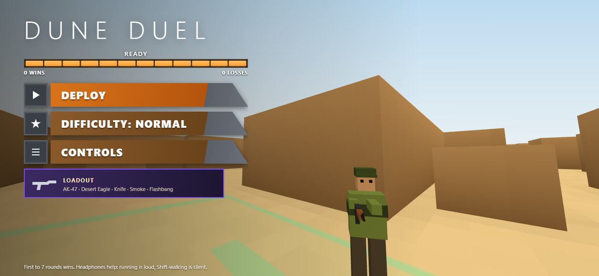
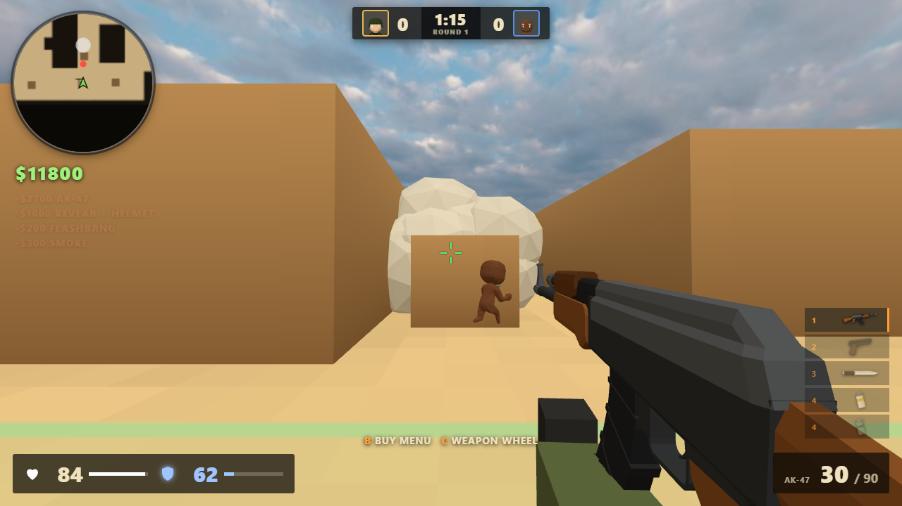

# Dune Duel

A low-poly 1v1 first-person shooter that runs in the browser. You play against a bot on a compact
three-lane desert map: **Long A** down the right, **Mid** through the centre, **B Tunnels** on the left.





Weapons: **AK-47**, **Desert Eagle**, **knife**, plus **smoke** and **flashbang** grenades. Nothing else.
First to 7 rounds wins; sides swap every round.

Built with [Three.js](https://threejs.org/) and no other dependencies. Everything (models, map, sound) is
generated in code, so there are no asset files.

## Run it

ES modules do not load from `file://`, so serve the folder:

```bash
python -m http.server 8000
```

Open http://localhost:8000. A loading bar fills as the map and bot are built, then **Deploy** starts a match. The
menu also cycles difficulty and shows the controls and sensitivity slider. Chrome, Edge and Firefox work.
Mouse look uses pointer lock; press `Esc` to pause.

## Controls

| Key | Action |
| --- | --- |
| `W A S D` / `Space` | Move / jump |
| `Shift` | Walk (silent) |
| Mouse / `LMB` | Aim / fire (`RMB` = knife stab) |
| `R` | Reload |
| `1` `2` `3` | AK-47 / Desert Eagle / Knife |
| `4` `5` | Smoke / Flashbang (`LMB` to throw) |
| `Q` | Last weapon |
| `Enter` or click | Play again after a match |

## How it plays

- **Sound matters.** Running is loud, `Shift`-walking is silent, and the bot hears both gunfire and footsteps.
  Shots and steps are positional, so headphones help.
- **Smoke blocks sight for both sides.** The bot cannot see you through it, and you cannot see it.
- **Flashbangs blind whoever looks at them.** Turn away to shorten the blind. The bot can be flashed too.
- **Headshots** do 4x damage: one Deagle headshot or one AK headshot kills. Body shots: AK 34, Deagle 53.
- **Knife:** slash 40, stab 75, and a stab from behind kills.
- The bot follows the same rules: it needs line of sight, reacts after a delay, can be blinded, and uses its
  own smoke and flash.

## How it is built

| File | Role |
| --- | --- |
| `src/map.js` | The map as a 90x90 grid. One grid drives rendering, collision, bullets, line of sight and bot pathfinding (A*), so they cannot disagree. |
| `src/world.js` | Turns the grid into merged low-poly meshes and the minimap. |
| `src/main.js` | Game loop, player, weapons, grenades, rounds, HUD. |
| `src/bot.js` | Opponent AI: perception, A* movement, aiming, grenade use. |
| `src/fx.js` | Pooled muzzle flashes, tracers, impacts and low-poly smoke. |
| `src/weapons.js` | Weapon stats and models built from boxes and cylinders. |
| `src/audio.js` | WebAudio-synthesised sound effects. |
| `vendor/` | Three.js r160 and its geometry utilities, vendored so the game works offline. |

Performance choices: a single merged mesh for walls and one for the floor, no real-time shadows, pooled
effects, pixel ratio capped at 1.5, and grid raycasts instead of mesh raycasts for bullets.

## The map

The layout is a condensed 1v1 take on a classic desert map, built after studying its top-down overview and
callouts. Spawns are at the bottom (T) and top (CT), with the two bombsite-style areas **A** (top right) and
**B** (top left) marked on the floor. It keeps the three lanes and the main rotations (Short from CT to A,
B doors from Mid to B) at a size that suits a duel. Walkable space and cover are defined as rectangles at the
top of `src/map.js`, so the layout is easy to change.

## Author

Made by [AshR3x](https://github.com/AshR3x) with [Claude](https://claude.com/claude-code) (Anthropic) as a coding collaborator. Released under the [MIT License](LICENSE).
Three.js (in `vendor/`) is MIT licensed by its own authors.

## Notes

This is an independent hobby project. It is not affiliated with or endorsed by Valve or the makers of any
game that inspired it, and it uses none of their assets.
