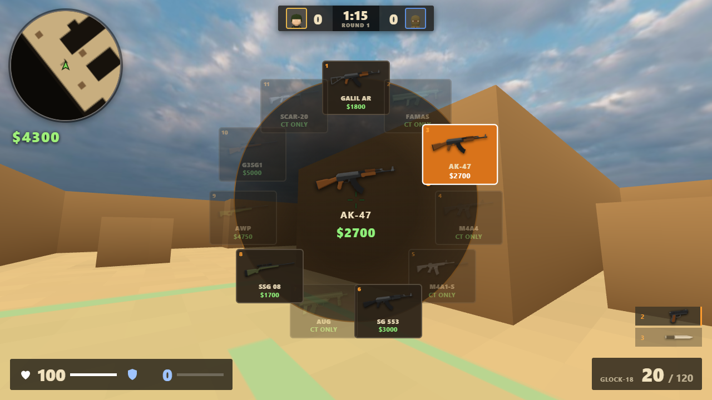
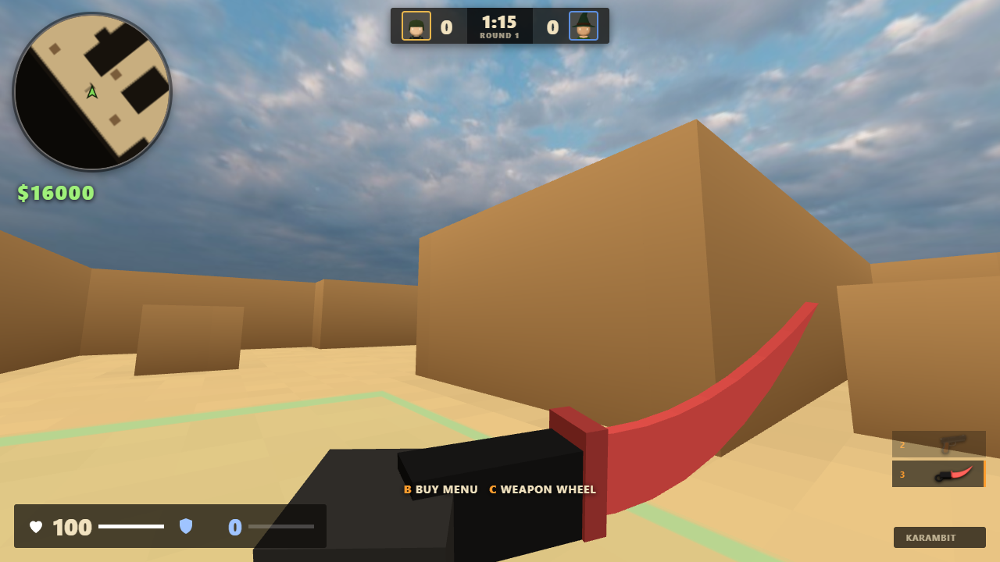

# Dune Duel

A low-poly 1v1 first-person shooter that runs in the browser. You play against a bot on a compact
three-lane desert map: **Long A** down the right, **Mid** through the centre, **B Tunnels** on the left.


| Buy wheel with item pictures | Karambit with a custom blade colour |
| --- | --- |
|  |  |

Weapons: the full CS:GO-style arsenal (8 pistols, 6 SMGs, 7 rifles, 4 snipers, 4 shotguns, 2 LMGs, knife, Zeus) plus
HE, flashbang, smoke, molotov/incendiary and decoy grenades, armor and helmets. You earn cash from kills and rounds
and spend it in a radial buy wheel with pictures of every item. First to 7 rounds wins; sides swap at halftime (after round 6).

Also in: aim down sights and scopes, crouching (for you and the bot), weapon inspect, a CS:GO-style HUD with a round
rotating radar and kill feed, a main menu where you pick your character, knife (combat knife, karambit or butterfly
knife) and blade colour, and a random character skin for the enemy every round.

Built with [Three.js](https://threejs.org/) and no other dependencies (its FBX loader is vendored). The map, grenades, knives and sound are
generated in code. Most guns use the CC0 [Ultimate Gun Pack](https://quaternius.com/packs/ultimategun.html) by
Quaternius (FBX files in `assets/guns/`); the M249, Negev, P90 and Zeus fall back to built-in models.
The sky is the CC0 "Citrus Orchard Puresky" HDRI from [Poly Haven](https://polyhaven.com/a/citrus_orchard_puresky),
tone-mapped to a 2K JPEG (`assets/sky/sky.jpg`).
The 52 rigged characters in `assets/characters/` come from Quaternius's CC0
[Ultimate Animated Character Pack](https://quaternius.com/): pick yours in the main menu (drag the backdrop to rotate
it); the enemy bot gets a random one every round.

## Run it

ES modules do not load from `file://`, so serve the folder:

```bash
python -m http.server 8000
```

Open http://localhost:8000. A loading bar fills as the map and bot are built, then **Deploy** starts a match. The
menu also cycles difficulty and shows the controls and sensitivity slider. Chrome, Edge and Firefox work.
Mouse look uses pointer lock; press `Esc` to pause.

## Controls

| Key | Action |
| --- | --- |
| `W A S D` / `Space` | Move / jump |
| `Shift` | Walk (silent) |
| `Ctrl` (hold) | Crouch: slower, quiet, steadier aim, harder to hit |
| Mouse / `LMB` | Aim / fire |
| `RMB` | Hold: aim down sights. Scoped guns (AWP, SSG 08, G3SG1, SCAR-20, AUG, SG 553): click to cycle zoom. Knife: stab. Grenades: lob |
| `R` | Reload |
| `1` `2` `3` | Primary / pistol / knife |
| `4` `5` | Cycle grenades / Zeus |
| `Q`, mouse wheel | Last weapon / cycle weapons |
| `C` (hold) | Weapon wheel: move the mouse, release to pick |
| `B` | Buy wheel (freeze time + first seconds): click a category, click an item, `RMB` back; `1`-`9` also pick |
| `F` | Inspect your weapon (any time you are not firing, reloading or aiming) |
| `E` / `G` | Pick up / drop weapon (the bot drops its guns when it dies) |
| `Enter` or click | Play again after a match |

## Economy

Start each half with $800 (max $16000). Kill rewards follow CS:GO: rifles $300, SMGs $600, shotguns $900, AWP $100,
knife $1500. A round win pays $3250; a loss pays $1400, growing by $500 per consecutive loss up to $3400. Survivors
keep their gear; dead players fall back to the default pistol. With no bomb, time running out is a CT win.
Grenade kills pay $300, Zeus kills nothing, P90 and CZ75 kills $300 and $100. Armor with a helmet is $1000, or $350 on top of kevlar
you already have. Carry up to 4 grenades (2 flashes, 1 of each other kind). The loss counter drops by one per win and resets,
along with money and gear, at halftime.
The bot buys by the same rules (full buy, force buy, eco or save).

## How it plays

- **Sound matters.** Running is loud, `Shift`-walking is silent, and the bot hears both gunfire and footsteps.
  Shots and steps are positional, so headphones help.
- **Smoke blocks sight for both sides.** The bot cannot see you through it, and you cannot see it.
- **Flashbangs blind whoever looks at them.** Turn away to shorten the blind. The bot can be flashed too.
- **Damage model** follows CS:GO: per-weapon damage, armor penetration and range falloff, 4x headshots, 1.25x stomach, 0.75x legs. Armor soaks damage; helmets protect the head.
- **Knife:** slash 40, stab 75, and a stab from behind kills.
- **Crouching:** hold `Ctrl` to crouch. The bot crouches too when it holds position in a fight: its body folds, its eye and head drop, and its hitbox shrinks.
- The bot follows the same rules: it needs line of sight, reacts after a delay, can be blinded, and uses its
  own smoke and flash.

## How it is built

| File | Role |
| --- | --- |
| `src/map.js` | The map as a 90x90 grid. One grid drives rendering, collision, bullets, line of sight and bot pathfinding (A*), so they cannot disagree. |
| `src/world.js` | Turns the grid into merged low-poly meshes and the minimap. |
| `src/main.js` | Game loop, player, weapons, grenades, rounds, HUD. |
| `src/bot.js` | Opponent AI: perception, A* movement, aiming, grenade use. |
| `src/fx.js` | Pooled muzzle flashes, tracers, impacts and low-poly smoke. |
| `src/weapons.js` | CS:GO-style weapon table, damage and armor model, knives, and the procedural fallback models. Loads the Quaternius gun models. |
| `src/characters.js` | Rigged character loader: recolouring, animation state and the procedural crouch pose. |
| `src/icons.js` | Renders the item pictures (guns, grenades, armor) and head portraits used by the wheels, HUD and kill feed. |
| `assets/` | `guns/` (Quaternius gun FBX files), `characters/` (52 character FBX files), `sky/` (tone-mapped HDRI). |
| `src/audio.js` | WebAudio-synthesised sound effects. |
| `vendor/` | Three.js r160, its geometry utilities and the FBX loader (with fflate), vendored so the game works offline. |

The repository is about 120 MB because of the character models; they load one at a time, on demand.

Performance choices: a single merged mesh for walls and one for the floor, no real-time shadows, pooled
effects, pixel ratio capped at 1.5, and grid raycasts instead of mesh raycasts for bullets.

## The map

The layout is a condensed 1v1 take on a classic desert map, built after studying its top-down overview and
callouts. Spawns are at the bottom (T) and top (CT), with the two bombsite-style areas **A** (top right) and
**B** (top left) marked on the floor. It keeps the three lanes and the main rotations (Short from CT to A,
B doors from Mid to B) at a size that suits a duel. Walkable space and cover are defined as rectangles at the
top of `src/map.js`, so the layout is easy to change.

## Author

Made by [AshR3x](https://github.com/AshR3x) with [Claude](https://claude.com/claude-code) (Anthropic) as a coding collaborator. Released under the [MIT License](LICENSE).
Three.js (in `vendor/`) is MIT licensed by its own authors. The gun and character models are CC0 by Quaternius, and the sky is CC0 from Poly Haven.

## Notes

This is an independent hobby project. It is not affiliated with or endorsed by Valve or the makers of any
game that inspired it, and it uses none of their assets.
